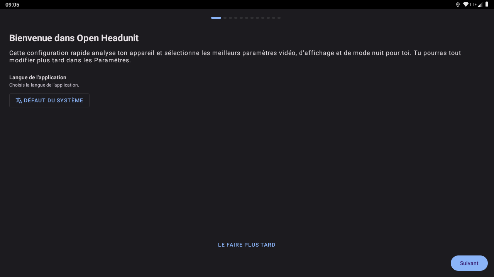
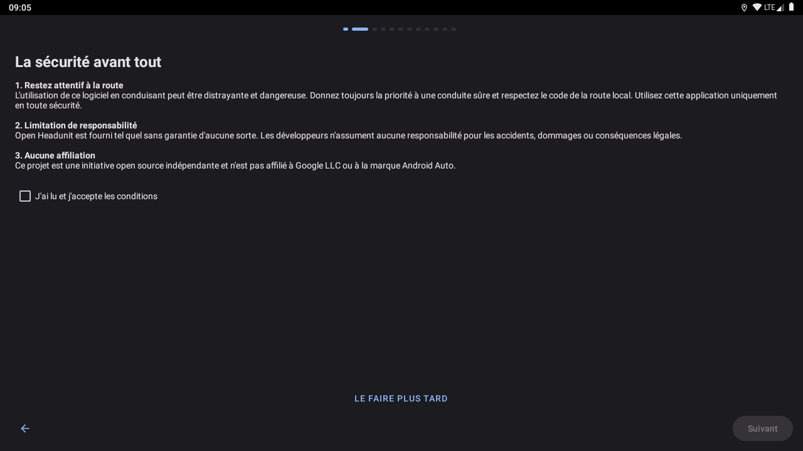

# Open Headunit LibreHU

Fork d'[Open Headunit](https://github.com/andreknieriem/headunit-revived) (ex-Headunit Revived, de Michael Reid
puis Andre Rinas), recepteur Android Auto en appli Android, pour les autoradios LibreHU (AC8257 / UJC201).
Licence inchangee : **AGPL-3.0** (voir `LICENSE` et `COPYRIGHT_MICHAEL_REID_GPLv3AFFERO.txt`) ; le code de ce fork
est publie avec ses APK.

## Captures d'écran

| | |
|---|---|
| <br>Assistant de premier démarrage | <br>Configuration (2) |
| <br>Écran principal |   |

Captures sur l'émulateur Android 9 (1280×720, 160 dpi comme l'autoradio), sans autoradio branché : les valeurs du véhicule et de la MCU sont vides. Refaites-les avec l'action **Screenshots** de [LibreHU-OTA-app](https://github.com/LibreHU/LibreHU-OTA-app/tree/main/screenshots). Galerie : [librehu.github.io/screenshots/headunit.html](https://librehu.github.io/screenshots/headunit.html).

## Ce que change le fork
- **Appairage Bluetooth automatique d'un nouveau téléphone branché en USB** : Android Auto demande l'appairage par
  la session USB (service Bluetooth, message PairingRequest 0x8001) ; Open Headunit ne répondait pas, le téléphone ne
  s'appairait donc jamais et ne pouvait pas continuer sans fil au débranchement. Le fork reprend l'assistance
  d'appairage de la PR amont #1156 (emotionbug, non fusionnée en amont) et, sur un autoradio LibreHU : l'active aussi
  en USB ; se fie à l'adresse Bluetooth lue par LibreHU-service (Android 8+ cache celle de l'adaptateur aux applis) ;
  lance l'appairage depuis l'autoradio vers l'adresse donnée par le téléphone, lui demande d'attendre
  (PAIRING_DELAYED), envoie le nombre de comparaison à Android Auto (AuthenticationData 0x8003) et répond le résultat
  (SUCCESS ou UNAVAILABLE). Côté autoradio, LibreHU-service accepte l'appairage quand il gère le Bluetooth. Activé
  par le préréglage LibreHU (version 4). Non encore testé sur un vrai téléphone : journal `AAP Bluetooth`.
- **Canal du groupe Wi-Fi Direct choisi d'après le Wi-Fi de l'autoradio** (mode Android Auto natif, sans fil) : la
  puce de l'AC8257 n'a qu'une radio, sans DBDC ; un groupe sur un autre canal que le réseau auquel l'autoradio est
  connecté la fait alterner entre les deux (MCC). Journaux du 27/10/2026 : box sur 2462 MHz, groupe sur 5180 MHz,
  ~95 bascules par réseau en 85 s, Wi-Fi client à 23 Ko/s et téléphone qui ne rejoint pas le groupe à temps.
  Maintenant, sans canal imposé dans les réglages : **Wi-Fi client sur un canal 5 GHz hors DFS** (36-48, 149-161) →
  le groupe est demandé **sur ce canal** (plus d'alternance) ; client en 2,4 GHz, en DFS ou non connecté → groupe sur
  un canal 5 GHz hors DFS (36 d'abord), car Android Auto sans fil demande le 5 GHz (alternance inévitable avec une
  seule radio quand le client reste connecté) ; le palier 2,4 GHz de secours prend le canal 2,4 GHz du client. Un canal
  choisi à la main dans les réglages reste prioritaire. Android 9 : échelle `setWifiP2pChannels`
  (`WifiP2pOperatingChannelPolicy.attemptChannels`, `sharedStationChannel`) ; Android 10+ :
  `setGroupOperatingFrequency` (`NativeGroupBandPolicy.requestedFrequencyMhz`). Journal :
  « station on channel N … the group is asked for it first ».
- **Vidéo basse latence activée par le préréglage LibreHU** (version 3) : le réglage d'Open Headunit
  « Request decoder low-latency mode » (`debug-video-low-latency`, désactivé en amont) passe à oui si personne ne l'a
  encore touché : `vdec-lowlatency` sur le décodeur MediaTek (pas de `KEY_LOW_LATENCY` avant Android 11), retiré par
  l'échelle de configuration du décodeur s'il est refusé, comme chez Moonlight. Interrupteur aussi dans LibreHU-service
  (page Android Auto).
- **Paquet `org.librehu.headunit`** (« Open Headunit LibreHU ») : s'installe a cote d'Open Headunit. Le namespace du
  code et les actions d'automatisation (`com.andrerinas.openheadunit.ACTION_*`) ne changent pas.
- **Nom et icone** : affiche « Android Auto » sous l'icone (role de l'appli sur l'autoradio). L'icone est
  originale (fleche de navigation Material, Apache-2.0, sur fond vert), avec un glyphe blanc
  (`org.librehu.themed_icon`) que LibreHU Launcher colore avec l'accent du theme. Le logo Android Auto de Google n'est
  pas repris : marque reservee (voir « Marques » ci-dessous). Pour mettre une autre image sur son autoradio : appui
  long sur l'appli dans LibreHU Launcher → « Changer l'icone ».
- **Signe avec la cle LibreHU** (la meme que toutes les applis LibreHU) : LibreHU-service et LibreHU Launcher lui
  font confiance par signature. Les `*.jks` sont ignores par git ici : la CI prend le secret `LIBREHU_KEYSTORE_B64`, ou
  a defaut telecharge `keystore/librehu.jks` de LibreHU-service ; elle refuse de publier un APK non signe
  (`apksigner verify`), qu'Android refuserait (« Failed to collect certificates »).
- **`LibreHuAutomationReceiver`** : les memes commandes que `AutomationReceiver`, reservees aux applis signees avec
  la cle LibreHU (permission signature `org.librehu.headunit.permission.CONFIGURE`), configuration comprise sans le
  reglage « Autoriser la configuration externe » (qui reste la barriere pour toutes les autres applis).
- **Navigation virage par virage** : `NAVIGATION_UPDATE` est envoye avec la permission signature
  `org.librehu.headunit.permission.NAVIGATION_UPDATE`, declaree par ce paquet (celle d'Open Headunit,
  `com.andrerinas.headunitrevived.permission.NAVIGATION_UPDATE`, n'est declaree par aucune appli : personne ne
  recevait ces diffusions). LibreHU Launcher l'affiche sur le tableau de bord.
- **Numero de version** : `versionCode` = celui d'amont (121 depuis 4.0.0-beta1) + nombre de commits du depot. LibreHU Apps propose une
  mise a jour quand le `versionCode` augmente ; celui d'amont ne bougeait pas d'un build du fork a l'autre, la mise a
  jour n'apparaissait donc pas. Le `versionName` reste celui d'amont suivi de `-<branche>` ; le commit est sur sa propre ligne de `release.txt`.
- **CI** (`.github/workflows/librehu.yml`) : saveur `github` en release, publiee en pre-release continue
  `latest-<branche>` avec `release.txt` (LibreHU Apps) et en compilations numerotees ; les workflows d'Open Headunit
  propres a son depot (revue Gemini, issues inactives, APK debug) sont retires, `android-ci.yml` garde.

## Root (SuperSU) : demandé une fois pour toutes

Le fork utilise le root (comme Open Headunit, pour certaines connexions) par SuperSU (installé dans la ROM) ; chaque demande doit être accordée avec « Se
souvenir ». Pour que toutes les fenêtres SuperSU arrivent au même moment, l'assistant de premier démarrage de LibreHU
Launcher (« Autoriser le root pour toutes les applis LibreHU ») interroge chaque appli LibreHU l'une après l'autre :
`RootRequestReceiver`, sur `org.librehu.action.REQUEST_ROOT` envoyé à ce paquet, lance une fois `su -c id` (SuperSU
affiche alors la demande de cette appli), puis répond `org.librehu.action.ROOT_RESULT` (extras `package`, `granted`)
au paquet indiqué dans `reply_to`. Rien d'autre que `id` n'est lancé ; une seconde demande dans les 20 s est ignorée. Seule une appli signée avec la clé LibreHU peut l'envoyer (permission de signature `org.librehu.permission.ROOT_REQUEST`, déclarée dans `AndroidManifest.xml`).

## Fichiers modifiés par rapport à l'amont

Base : commit amont `620af558` (Open Headunit 4.0.0-beta1 + 3 commits audio, 27/10/2026 ; bases précédentes `2018d8f0`, `4ee1d58f`),
branche locale `librehu` publiée sur `main`. `git diff 620af558 HEAD --stat` donne la liste complète ; chaque modification du code est
marquée `LibreHU fork:` en commentaire.

| Fichier(s) | Modification |
|---|---|
| `app/build.gradle.kts` | `applicationId` `org.librehu.headunit`, signature par la clé LibreHU, `versionCode` = 121 + nombre de commits |
| `app/src/main/AndroidManifest.xml` | permissions signature `CONFIGURE` et `NAVIGATION_UPDATE` déclarées par ce paquet ; `LibreHuAutomationReceiver`, `LibreHuVideoService`, `RootRequestReceiver` ; lecture des fournisseurs LibreHU (thème du launcher, fiche voiture) ; icône thémable |
| `App.kt` | démarrage de `LibreHuTheme`, `LibreHuDefaults`, `LibreHuVehicleSync`, `LibreHuCar` |
| `automation/LibreHuAutomationReceiver.kt` (nouveau) | commandes d'automatisation réservées aux applis signées LibreHU, configuration comprise |
| `automation/AutomationCommandPolicy.kt`, `AutomationEffectRunner.kt` | mode nuit `car` (signal des phares) avec `headlight=on/off` venant de LibreHU-service |
| `librehu/LibreHuCar.kt` (nouveau) | état de la voiture et touches venant de LibreHU-service → capteurs Android Auto (frein à main, vitesse, régime, carburant, température, phares / clignotants, rapport), chacun désactivable ; phares pour le mode nuit et le thème |
| `librehu/LibreHuDefaults.kt` (nouveau) | pré-configuration LibreHU (version 2), seulement pour les réglages jamais choisis |
| `librehu/LibreHuTheme.kt` (nouveau) | clair / sombre, accent et style (usine / ambiance) de LibreHU Launcher, posés sur chaque thème d'activité |
| `librehu/LibreHuVehicleSync.kt` (nouveau) | fiche voiture de LibreHU-service → réglages véhicule envoyés au téléphone |
| `librehu/LibreHuVideoService.kt` (nouveau) | image d'Android Auto dans une carte de LibreHU Launcher (expérimental) |
| `librehu/RootRequestReceiver.kt` (nouveau) | root demandé une fois pour toutes depuis l'assistant du launcher |
| `aap/AapControl.kt`, `aap/protocol/messages/ServiceDiscoveryResponse.kt` | capteurs de la voiture annoncés au téléphone et dernière valeur envoyée à sa demande |
| `aap/AapControl.kt`, `librehu/LibreHuCar.kt` | `BatteryStatusNotification` (message de contrôle 23) du téléphone, s'il l'envoie : niveau de batterie journalisé et envoyé à LibreHU-service (`org.librehu.headunit.PHONE_BATTERY`) |
| `aap/AapNavigationHelper.kt` | `NAVIGATION_UPDATE` envoyé avec la permission déclarée par ce paquet ; extra `org.librehu.projection_on_screen` (projection au premier plan ou non) pour le popup des directions de LibreHU Launcher |
| `app/BaseActivity.kt`, `app/SurfaceActivity.kt`, `main/AppDrawerFragment.kt`, `main/QuickSettingsFragment.kt` | accent du launcher sur chaque thème d'activité et de dialogue plein écran |
| `main/HomeFragment.kt`, `main/KeymapFragment.kt` | couleur d'état et du débogueur de touches = accent du launcher au lieu du sarcelle |
| `main/DarkModeFragment.kt`, `main/OnboardingActivity.kt` | option « Suivre le launcher LibreHU » ; thème grisé dans l'assistant quand le launcher décide |
| `main/LibreHuCarFragment.kt` (nouveau), `res/layout/fragment_librehu_car.xml`, `res/navigation/nav_graph.xml`, `main/SettingsFragment.kt` | réglages « Voiture et touches (LibreHU) » |
| `utils/AppThemeManager.kt`, `utils/NightModeManager.kt` | mode « Signal des phares (ILL+) » nourri par les phares de LibreHU-service (puis `car_mode` comme l'amont) |
| `utils/Settings.kt`, `utils/SettingsBackupManager.kt` | réglages LibreHU (suivi du thème, capteurs, touches, carte vidéo, version de pré-configuration), inclus dans les sauvegardes |
| `res/values/attrs_librehu.xml`, `colors_librehu.xml`, `values-night/colors_librehu.xml`, `styles_librehu.xml`, `styles.xml` | attributs `librehuAccent` / `librehuOnAccent` et `ThemeOverlay.LibreHU.*` (8 accents du launcher) |
| `res/layout/dialog_*.xml`, `fragment_add_network_address.xml`, `item_keymap.xml`, `layout_*_button.xml`, `res/color-v23/*`, `res/drawable-v21/btn_primary.xml` | couleurs codées de la marque (`brand_primary`, ex-`brand_teal`) remplacées par `?attr/librehuAccent` |
| `res/drawable/librehu_launcher_*.xml`, `res/mipmap-anydpi-v26/ic_launcher*.xml` | icône originale et glyphe thémable |
| `res/values/strings.xml`, `values-fr/strings.xml` | nom « Android Auto » sous l'icône, textes LibreHU (anglais, français) |
| `res/xml/shortcuts.xml` | raccourcis vers le paquet `org.librehu.headunit` |
| `app/src/test/.../AutomationCommandPolicyTest.kt` | test du mode nuit `car` |
| `aap/AapBluetoothControl.kt`, `aap/bluetooth/*`, `proto/bluetooth.proto`, `aap/AapControl.kt`, `protocol/messages/ServiceDiscoveryResponse.kt` (PR amont #1156) ; `librehu/LibreHuDefaults.kt` ; `app/src/test/.../BluetoothPairingSessionTest.kt` | messages d'appairage Bluetooth d'Android Auto ; ajouts LibreHU : sessions USB, adresse de LibreHU-service, appairage lancé par l'autoradio, préréglage v4 ; tests |
| `connection/wifi/direct/WifiP2pOperatingChannelPolicy.kt`, `NativeGroupBandPolicy.kt`, `WifiDirectManager.kt`, `app/src/test/.../WifiP2pOperatingChannelPolicyTest.kt` | canal du groupe Wi-Fi Direct = celui du Wi-Fi client quand c'est un canal 5 GHz utilisable (sinon 5 GHz hors DFS), palier 2,4 GHz sur le canal du client ; tests |
| `.github/workflows/librehu.yml` (nouveau) ; `build-debug-apk.yml`, `close-inactive-issues.yml`, `gemini-code-review.yml` (retirés) | CI LibreHU (APK signé, `latest-main`, `release.txt`) ; workflows propres au dépôt d'amont retirés |
| `README.md`, `README_LIBREHU.md` | renvoi vers ce fichier ; ce fichier |

## Installation
Depuis **LibreHU Apps** (catalogue : « Android Auto (Open Headunit LibreHU) »), ou l'APK de la pre-release
`latest-main` de ce depot.

## Integration LibreHU
- **Vehicule** (`librehu/LibreHuVehicleSync.kt`) : au demarrage et a chaque changement, le nom de la voiture, la
  marque, le modele, l'annee, le cote conducteur et l'adresse Bluetooth de l'autoradio (qu'Android cache aux
  applis) viennent de LibreHU-service (`content://org.librehu.service.vehicle/info`, permission signature
  `org.librehu.permission.VEHICLE`) et remplissent les reglages vehicule d'Open Headunit (envoyes au telephone a la
  connexion). Une valeur vide laisse celle d'Open Headunit.
- **Theme du launcher** (`librehu/LibreHuTheme.kt`) : clair / sombre et couleur d'accent de LibreHU Launcher
  (`content://org.librehu.launcher.theme/theme` et diffusion `org.librehu.action.THEME_CHANGED`), suivis en direct.
  L'accent du launcher (un de ses 8 : bleu, sarcelle, vert, jaune, orange, rouge, rose, violet, en variante claire ou
  sombre) remplace le sarcelle d'Open Headunit : boutons, interrupteurs, dialogues, barres de progression. Les styles
  et les mises en page passent par l'attribut `?attr/librehuAccent` (et `?attr/librehuOnAccent` pour le texte pose
  dessus), et un `ThemeOverlay.LibreHU.*` est pose sur chaque theme d'activite et de dialogue plein ecran. Le mode
  jour / nuit de l'appli devient celui du launcher ; le moteur d'Open Headunit (capteur de lumiere, lever du soleil…)
  est alors en pause. Le launcher demande aussi son **style** a l'appli (colonne / extra `style`) : style
  « Modularer Infotainment-Baukasten » (`factory`) → `ThemeOverlay.LibreHU.Factory` (police Source Sans 3, Adobe,
  SIL OFL 1.1 : `third_party/SourceSans3-LICENSE.md`, coins carres) ; style « LHU-Link » (`ambient`) →
  `ThemeOverlay.LibreHU.Ambient` (texte fin, coins carres). Pas de fond d'ecran impose : la surcouche va aussi sur
  les activites transparentes. Option **Reglages → Mode sombre → « Suivre le launcher LibreHU »** : activee par defaut et
  visible seulement si le launcher est installe. Desactivee, les reglages de theme d'Open Headunit reviennent. La
  projection n'est pas recreee (seulement un changement de configuration), donc la video continue.
- **Pre-configuration LibreHU** (`librehu/LibreHuDefaults.kt`) : appliquee une fois, si LibreHU Launcher ou
  LibreHU-service est installe, et **seulement pour les reglages jamais choisis**. Un choix de l'utilisateur ou une
  sauvegarde importee reste.

  | Reglage | Valeur | Pourquoi |
  |---|---|---|
  | Demarrage au branchement USB | active | rien a ouvrir a la main en montant en voiture |
  | Connexion automatique si un seul appareil | activee | un seul telephone branche : rien a choisir |
  | Orientation | paysage fixe | dalle 1280x720 montee en paysage |
  | Lecture en cours d'Android Auto dans la session media | activee | titre, artiste et pochette dans le lecteur du launcher et pour les touches du volant |
  | Theme de l'appli (quand il ne suit pas le launcher) | Signal des phares (ILL+) | les phares envoyes par LibreHU-service (version 2 de la pre-configuration) |

  Ce qui reste hors de la pre-configuration :
  - la video (resolution, codec, rendu, densite), choisie par l'assistant de premier demarrage d'Open Headunit d'apres
    la taille de la dalle et les decodeurs H.264 / H.265 ;
  - le mode nuit envoye au telephone : LibreHU-service le met sur « Signal des phares (ILL+) » quand son
    interrupteur « nuit selon les phares » est actif (par defaut) ;
  - l'avertissement de securite de l'assistant, qui n'est pas saute.
- **Voiture et touches** (`librehu/LibreHuCar.kt`, Reglages → **Voiture et touches (LibreHU)**, visible si
  LibreHU-service est installe) : LibreHU-service envoie l'etat de la voiture et les touches par des diffusions que
  seules les applis signees LibreHU peuvent envoyer (permission `org.librehu.headunit.permission.CONFIGURE`).
  - **Capteurs Android Auto** annonces au telephone a la connexion, chacun coupable : frein a main (MCU), vitesse,
    regime, carburant, temperature exterieure (adaptateur OBD), phares et clignotants (MCU), rapport (seulement R / D
    d'apres la marche arriere, coupe par defaut). Le **frein a main** peut ne plus etre transmis du tout : il n'est
    alors ni annonce ni envoye, et le telephone se fie a sa propre estimation. Une information activee compte a la
    prochaine connexion ; coupee, elle n'est plus envoyee tout de suite. La derniere valeur est renvoyee des que le
    telephone demande le capteur, et l'ecran montre les dernieres valeurs recues.
  - Ce qu'Android Auto fait de chaque capteur n'est pas documente publiquement ; les commentaires du protocole repris
    par Open Headunit (`sensors.proto`) notent le frein a main et la vitesse comme recus, la plupart des autres comme
    non exploites. Ils sont donc « envoyes », pas forcement « utilises ».
  - **Touches** (interrupteur) : lecture / pause, pistes, appel, raccrocher, Assistant vocal (bascule de l'assistant
    du telephone), via la table de touches d'Open Headunit ; le fork repond s'il a pris la touche, sinon elle garde
    son action habituelle cote LibreHU-service.
  - **GPS de l'autoradio** envoye au telephone (meme reglage que « Navigation GPS »).
- **Image dans la carte du launcher** (experimental, `librehu/LibreHuVideoService.kt`) : LibreHU Launcher se lie a ce
  service (permission signature `CONFIGURE`) et lui passe la surface de sa carte Android Auto ; le decodeur y dessine
  (image entiere mise a l'echelle de la carte) tant que l'ecran de projection n'est pas affiche, et Open Headunit
  redemande une image cle au telephone. Les touches de la carte reviennent en fractions de la carte (un doigt). Quand
  l'ecran de projection revient, sa surface reprend la main ; la carte partie, le focus video est rendu au
  telephone. Interrupteur dans Voiture et touches (LibreHU), active ; cote launcher : desactive par defaut.
- **Phares → mode sombre** : les modes « Signal des phares (ILL+) » (mode nuit d'Android Auto et theme de l'appli)
  lisent d'abord les phares envoyes par LibreHU-service (`ACTION_CAR` `headlight`, ou `ACTION_SET_NIGHT_MODE`
  `state=car` + `headlight=on/off`), puis, sans eux, `Settings.System car_mode` comme Open Headunit d'origine (cet
  autoradio ne le fournit pas). Le changement est applique tout de suite (pas d'anti-rebond), session en cours
  comprise.
- **LibreHU-service** (onglet Android Auto) : etat de la session (`com.andrerinas.headunitrevived.SESSION_STATE`),
  mode jour / nuit selon les phares (`ACTION_SET_NIGHT_MODE` : `car` et les phares pour ce fork, `day` / `night`
  pour Open Headunit d'origine), connexion USB, deconnexion, affichage, reglages ;
  marche aussi avec Open Headunit d'origine (sans la configuration).
- **LibreHU Launcher** : carte Android Auto sur le tableau de bord (etat, afficher, deconnecter) et prochaine
  manoeuvre de la navigation.

## Marques
Android Auto est une marque de Google LLC. Ce fork n'est ni affilie a Google ni certifie par Google ; le nom
« Android Auto » sous l'icone decrit seulement le protocole que l'appli recoit. Les directives de marque de Google
reservent l'usage du nom et du logo Android Auto aux produits approuves
([Brand guidelines](https://developer.android.com/distribute/marketing-tools/brand-guidelines)) : le logo n'est donc
pas inclus dans ce depot public.

## Suivre Open Headunit
```
git remote add upstream https://github.com/andreknieriem/headunit-revived.git   # deja fait dans ce clone
git fetch upstream && git merge upstream/main
```
Les changements du fork sont petits et commentes « LibreHU fork » pour garder les fusions simples.

Derniere fusion : 4.0.0-beta1 (27/10/2026, 331 commits : FFmpeg H.264 en ARM32, reprise du decodeur, correction PCM
adaptative, AAudio, identifiants WPP, nouveaux reglages et accueil, politique media XYAuto…). Conflits resolus en
gardant les ajouts LibreHU : accent du launcher dans les layouts et styles (`brand_teal` devenu `brand_primary` en
amont), ecran « Voiture et touches (LibreHU) » a cote du nouvel ecran d'amont propre a l'appareil, chaines LibreHU,
nom de l'appli. Le choix du canal Wi-Fi Direct d'apres le Wi-Fi de l'autoradio (`c77f7d3`) fusionne sans conflit.
Le test d'amont `AapPresentationTest` attend la permission `NAVIGATION_UPDATE` d'Open Headunit : adapte a celle de
ce paquet. Tests : 4 286, un seul en echec dans la suite complete (`WppTcpTlsTest`, test d'amont, passe seul ici
comme en amont : interaction d'ordre entre tests, code non touche par le fork).

**Thème de LibreHU Launcher** : l'accent du launcher (le plus proche des huit de ce fork, couleur RGB comprise) et,
quand elle y est choisie, sa **police d'afficheur à segments** en majuscules sans accents (« LibreHU Seg14 », tirée de
DSEG14 © keshikan, SIL Open Font License 1.1, voir `third_party/DSEG-LICENSE.txt`). Les couleurs du style rétro du
launcher (tirées de n'importe quelle couleur) ne sont pas suivies ici : ces écrans gardent leurs thèmes. Le launcher
publie son thème par `content://org.librehu.launcher.theme/theme` (colonnes `dark`, `accent`, `style`, `font`…) et
par la diffusion `org.librehu.action.THEME_CHANGED` (mêmes noms en extras).

## Soutenir le projet

LibreHU est développé bénévolement, sur le temps libre, et toutes ses applis restent gratuites. Si le projet vous est
utile, vous pouvez le soutenir par un don sur [Liberapay](https://liberapay.com/DokT/donate) (association française à
but non lucratif, dons récurrents) :

[](https://liberapay.com/DokT/donate)
[](https://liberapay.com/DokT/)

Ces dons vont au projet LibreHU, pas aux auteurs de Open Headunit : pour les soutenir, voir leur dépôt.
